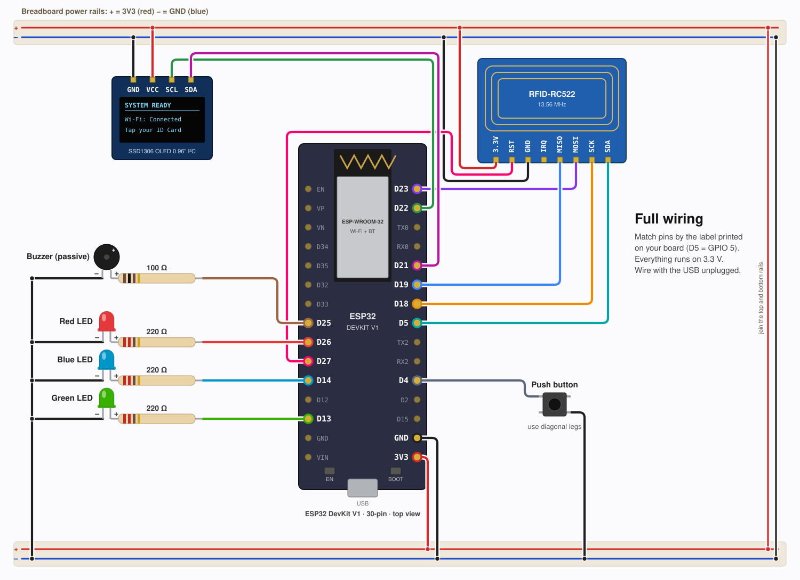
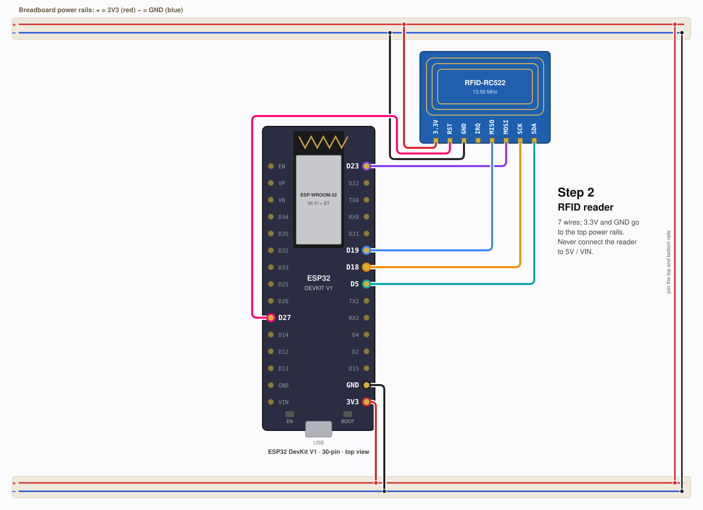
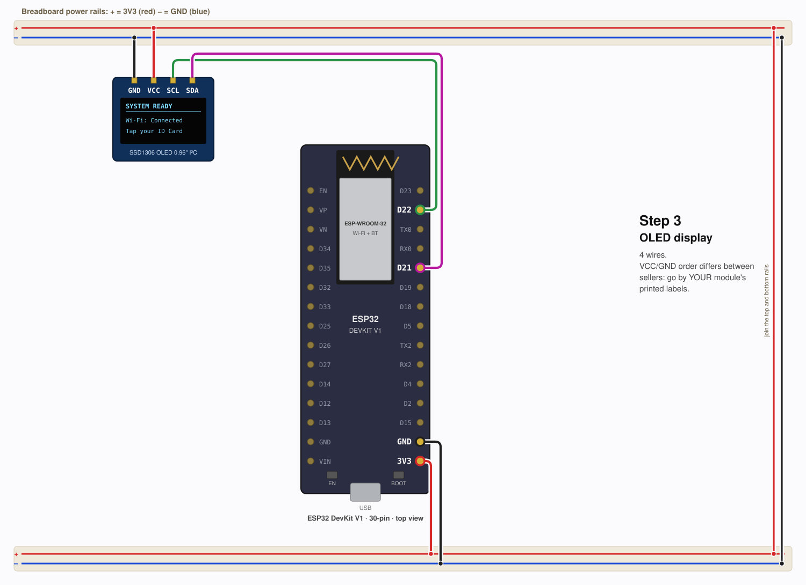
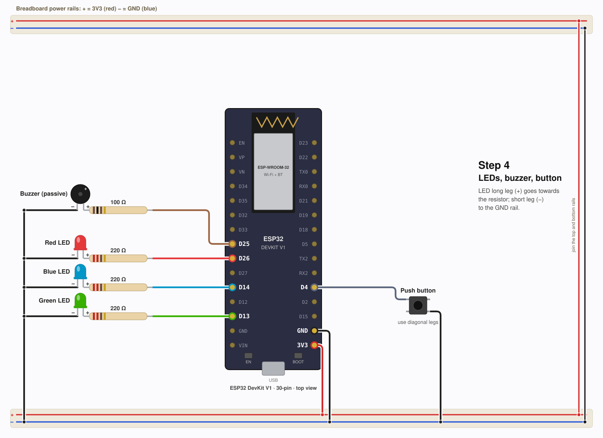

# 🎓 ESP32 Smart Attendance System (Arduino IDE)


An RFID-based classroom attendance system built on the ESP32.
Students tap a card → checked against the roster → logged on an OLED display with LED + buzzer feedback → uploaded to a **Google Sheet** automatically.

> **Duplicate attendance on the same calendar date is blocked** — both on the device and by the Google Apps Script backend.

> **Credential note:** The upload-ready sketch can contain your Wi-Fi credentials, Apps Script URL, and API key. Keep that credential-filled `SmartAttendance.ino` on your computer for Arduino IDE uploads. It is intentionally ignored by Git. The repository contains `SmartAttendance.ino.example` with placeholders for GitHub. Never force-add the filled sketch to a public repository.

---

## ✨ Features

| Feature | Details |
|---------|---------|
| 🔒 **Same-day duplicate block** | A student who already tapped today gets "ALREADY LOGGED" — the Apps Script also rejects duplicates server-side |
| ☁️ **Offline upload queue** | Accepted taps are saved to flash and retried when Wi-Fi is available; the queue holds up to 60 taps. When full, new taps are clearly rejected for retry instead of deleting older queued records. |
| 📡 **Auto reconnect** | Wi-Fi drops are recovered automatically; taps made offline upload later with the **original tap time** |
| 🌙 **Midnight rollover** | Attendance flags clear at midnight (via NTP) so the next day starts fresh |
| 📋 **Two-student demo roster** | Up to two students can be enrolled with `ENROLL`/`ADD`; the roster survives reboots |
| 🖥️ **Serial console** | Enroll/remove students, view roster, check status — all over the USB serial monitor |
| 🔆 **OLED + LED + Buzzer** | Visual and audible feedback for every scan result |

---

## 🛒 Parts List

| Part | Notes |
|------|-------|
| **ESP32 DevKit V1 (30-pin)** | Classic ESP-WROOM-32. Not S2/S3/C3/C6 |
| **MFRC522 RFID module (13.56 MHz)** | ⚠️ Must be 13.56 MHz (MIFARE). Many college ID cards are 125 kHz — test yours. **Solder the header pins** |
| **SSD1306 OLED 0.96″ 128×64 I²C** (4-pin) | ⚠️ SSD1306, not SH1106. Not the SPI version |
| **3 × LED** (green, red, blue) + **3 × 220 Ω resistors** | One resistor per LED — required |
| **Passive buzzer** + **1 × 100 Ω resistor** | Passive (no built-in oscillator) so `tone()` works |
| **Tactile push button** | Any momentary 4-leg button |
| Breadboard + jumper wires + USB **data** cable | Many USB cables are charge-only — the PC won't see the board |

---

## 🔌 Wiring

> **Everything runs at 3.3 V — never connect the MFRC522 to 5 V / VIN.**
> Wire with the USB cable **unplugged**.

### Complete connection diagram



### Build in stages

**Stage 1 — RFID reader**



**Stage 2 — Add the OLED display**



**Stage 3 — Add LEDs, buzzer, and reset button**



### Complete wiring table

| Module pin | → | ESP32 GPIO | Notes |
|---|---|---|---|
| **MFRC522** SDA (SS) | → | **5** | |
| MFRC522 SCK | → | **18** | |
| MFRC522 MOSI | → | **23** | |
| MFRC522 MISO | → | **19** | |
| MFRC522 RST | → | **27** | Not GPIO 21 — that's OLED SDA |
| MFRC522 3.3V | → | **3V3** | ⚠️ Not 5 V / VIN |
| MFRC522 GND | → | GND | |
| MFRC522 IRQ | | *not connected* | |
| **OLED** SDA | → | **21** | |
| OLED SCL | → | **22** | |
| OLED VCC | → | **3V3** | |
| OLED GND | → | GND | |
| **Green LED** anode | GPIO **13** → 220 Ω → anode | cathode → GND | |
| **Red LED** anode | GPIO **26** → 220 Ω → anode | cathode → GND | |
| **Blue LED** anode | GPIO **14** → 220 Ω → anode | cathode → GND | |
| **Buzzer** + | GPIO **25** → 100 Ω → buzzer + | buzzer − → GND | |
| **Reset button** | one leg → GPIO **4** | diagonally opposite leg → GND | internal pull-up, active-LOW |

> **Tip — go by the printed labels, not pin positions.**
> OLED pins vary by seller (`VCC GND SCL SDA` vs `GND VCC SCL SDA`). Swapping VCC ↔ GND destroys the display.

### Step-by-step build order

Build one stage at a time and verify before adding the next:

**Step 1 — Bare board**
Plug in USB only. Open the Serial Monitor at 115200. You should see the boot log, Wi-Fi connect, and `Clock set via NTP`.

**Step 2 — Add the MFRC522 RFID reader (7 wires)**
Boot log shows `MFRC522 version 0x92 (OK)` (or 0x91 / 0x12 / 0x88 / 0xB2 — clones are fine).
`0x00` or `0xFF` → recheck the 7 wires and ensure the header pins are soldered.
Tap a card → `[SCAN] UID: xxxxxxxx`

**Step 3 — Add the OLED display (4 wires)**
Boot log shows `OLED found at I2C 0x3C`.
Screen shows `SYSTEM READY`.

**Step 4 — Add LEDs, buzzer, and button**
Type `SELFTEST` in the Serial Monitor → green, red, blue LEDs light in sequence, then two beeps.
Short-press the button → `Present: 0 / N` shown on the OLED.

---

## 💻 Arduino IDE Setup

### 1 — Install the ESP32 board package

1. Open **File → Preferences**
2. In *Additional Boards Manager URLs* paste:
   ```
   https://raw.githubusercontent.com/espressif/arduino-esp32/gh-pages/package_esp32_index.json
   ```
3. Open **Tools → Board → Boards Manager**, search `esp32`, install **esp32 by Espressif Systems**

### 2 — Install required libraries

**Sketch → Include Library → Manage Libraries**, install:

| Library | Author |
|---------|--------|
| `MFRC522` | GithubCommunity |
| `Adafruit SSD1306` | Adafruit |
| `Adafruit GFX Library` | Adafruit |

### 3 — Open and upload the sketch

1. Download or clone this repository.
2. Copy `SmartAttendance/SmartAttendance.ino.example` to `SmartAttendance/SmartAttendance.ino`.
3. In the copied `.ino`, fill in `WIFI_SSID`, `WIFI_PASSWORD`, `GOOGLE_SCRIPT_URL`, and `API_KEY`. Keep this credential-filled file local; Git ignores it.
4. Open `SmartAttendance/SmartAttendance.ino` in Arduino IDE.
5. **Tools → Board** → `ESP32 Dev Module`
6. **Tools → Port** → your ESP32 COM port
7. Click **Upload** ▶
8. Open **Tools → Serial Monitor**, set baud to **115200**

> If upload hangs at `Connecting...`, hold the board's **BOOT** button while it connects, then release.

---

## ☁️ Google Sheets Backend Setup

> Use a **personal Gmail account** — college Google Workspace accounts often block sharing a web app with "Anyone".

1. Create a new **Google Sheet**. Set the time zone: **File → Settings → Time zone** (must match your region so "today" is correct).

2. Go to **Extensions → Apps Script**. Copy the contents of [`backend/AppsScript.gs`](backend/AppsScript.gs) into the Apps Script editor. Replace its `API_KEY` placeholder with the same key used in your local upload sketch. Do not commit the real key to GitHub.

3. Create a tab named **Students** with this exact header row:

   | URN | Student Name | Card UID |
   |---|---|---|
   | Your first student's URN | Name | UID from Serial Monitor |
   | Your second student's URN | Name | UID from Serial Monitor |

   The firmware supports two enrolled students for this demo. Card UIDs belong in the separate roster tab; they will not appear in the attendance date cells. Format the **Card UID** column as **Plain text** before entering UIDs so leading zeroes are kept.

   To read each UID, open the ESP32 Serial Monitor at 115200 baud, enter `ENROLL Student 1`, and tap the first card or tag. Copy the `[SCAN] UID` value shown in Serial Monitor into that student's roster row. Repeat with `ENROLL Student 2` and the second credential. The device enrolls the card even though you did not know its UID beforehand.

4. **Deploy → New deployment → Web app**
   - Execute as: **Me**
   - Who has access: **Anyone**
   - Click **Deploy**, copy the `/exec` URL

5. **Authorize** the script when Google prompts:
   Your account → *Google hasn't verified this app* → **Advanced** → **Go to … (unsafe)** → **Allow**
   (It's your own script, asking for access to your own sheet.)

6. **Test from a browser** only after adding that UID to the Students tab: `<your /exec URL>?uid=<card-uid>&name=<student-name>&key=<your-api-key>`. Expect a success message and a `P` in the date column. Avoid sharing a URL that contains the key.

The script writes the matrix to **RFID Attendance**, with **URN**, **Student Name**, a spacer column, and one column per date. Each accepted scan writes **P** in the matching student's row for that day. New dates are added to the right. The **Students** roster tab can be hidden to keep the attendance view uncluttered; unhide it when you need to enter or update student details and card UIDs. Set the spreadsheet time zone to your local region so date columns match your local day.

7. After any later change to the script: **Deploy → Manage deployments → ✏️ Edit → New version → Deploy**.

---

## ⌨️ Serial Commands

Open the Serial Monitor at **115200 baud** and type any of these:

| Command | What it does |
|---------|-------------|
| `ENROLL <Name>` | Arm enroll mode — next card tapped (within 15 s) is enrolled under that name |
| `ADD <UID> <Name>` | Enroll by typing the UID directly, e.g. `ADD 3F2A9B10 Rahul Sharma` |
| `REMOVE <UID>` | Un-enroll a student (fix a typo: REMOVE then ENROLL again) |
| `LIST` | Show roster + who is present today |
| `STATUS` | Wi-Fi, clock, unsynced queue, reader version, free heap |
| `SELFTEST` | Blink all LEDs, beep, verify reader and OLED |
| `RESET` | Wipe today's attendance (enrolled students stay) |
| `HELP` | List all commands |

**Reset button** (GPIO 4):
- **Short press** → shows "Present: X / Y" on the OLED
- **Hold at power-on for ≥ 3 s**, then release → wipes today's attendance (outbox kept)

---

## ✅ First Power-On Checklist

1. Boot log shows `MFRC522 version 0x.. (OK)`, `OLED found`, `Wi-Fi connected`, `Clock set via NTP`, no `[CONFIG]` warnings
2. OLED shows `SYSTEM READY` / `Wi-Fi: Connected`
3. Type `SELFTEST` → green, red, blue LEDs in sequence, then two beeps
4. Type `ENROLL Student 1`, tap the first credential within 15 s; repeat with `ENROLL Student 2` for the second credential. Copy both `[SCAN] UID` values into the matching Students tab rows with the students' URNs and names.
5. After the Students tab is filled and the backend is deployed, tap an enrolled card → green LED, `WELCOME!`, then `ATTENDANCE LOGGED` and a `P` under today's date
6. Tap a third time → red LED, `ALREADY LOGGED` ← **duplicate blocking working**
7. Tap an unknown card → red LED, `ACCESS DENIED` + UID shown in Serial log

---

## 🛠 Troubleshooting

| Symptom | Likely cause |
|---------|-------------|
| PC doesn't see the board | Charge-only USB cable or missing CP2102/CH340 driver |
| `MFRC522 version 0x00` / `0xFF` | Loose SPI jumper, unsoldered header, or module not on 3.3 V |
| Card never detected | Card is 125 kHz (not MIFARE) — use the tags shipped with the MFRC522 |
| `OLED not found` | SDA/SCL swapped, or VCC/GND not connected |
| OLED shows shifted image | It's an SH1106 (most 1.3″ OLEDs), not SSD1306 |
| `Wi-Fi: Offline` forever | 5 GHz or enterprise/captive-portal network, wrong password, or SSID typo — use a 2.4 GHz phone hotspot |
| `Check API key!` | `API_KEY` in the sketch ≠ the one in the Apps Script, or script wasn't redeployed as a **new version** |
| `HTTP -1` / `-29312` | TLS / connection failure — retried automatically; check internet access |
| HTML page as response | Script isn't deployed as **Anyone** or is a college Workspace account |
| `BUTTON STUCK?` at boot | Button wired across two joined legs — use diagonally opposite legs |
| Everyone shows `ALREADY LOGGED` | Type `RESET` to clear today's attendance |

---

## 📄 License

MIT — see [LICENSE](LICENSE).

---
*Developed for the 3rd-semester IoT & Robotics Lab.*
